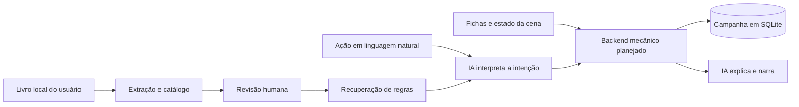

# Oráculo

**Um laboratório para construir um mestre de RPG por IA com regras verificáveis e campanhas persistentes.**

O objetivo é permitir que um jogador descreva uma ação em linguagem natural, enquanto a IA interpreta a intenção e um backend valida a mecânica, calcula o resultado e registra a mudança de estado. A IA então narra o que aconteceu. O projeto ainda está na fase de ingestão e revisão das regras; ele **não mestra uma campanha completa** hoje.

> **Material de jogo não incluído.** O repositório contém código, testes e documentação técnica. Livros, texto extraído, embeddings, fichas, campanhas e credenciais ficam apenas na máquina de quem executa o projeto.

## O que já funciona

| Camada | Implementado | Próximo passo |
| --- | --- | --- |
| Biblioteca de regras | Extração local de PDF, capítulos, chunks, embeddings opcionais e catálogo com proveniência | Ampliar a cobertura e tratar tabelas complexas |
| Catálogo visual | Separação por títulos e colunas de habilidades, perícias, vantagens, efeitos, exemplos de poder, extras e falhas | Revisar cada item e estruturar sua mecânica |
| Revisão humana | Interface local para ler, editar, restaurar e aprovar trechos; aprovações ligadas à versão do texto | Revisar o corpus completo |
| Perguntas | Busca de regras relacionadas e resposta opcional por modelo, com envio externo explícito | Medir acerto mecânico com casos de teste |
| Campanhas | SQLite para campanhas, NPCs, sessões, eventos e propostas da IA | Validar ações e aplicar mudanças de estado |

No corpus local de desenvolvimento, o catálogo separou **218 itens** em sete categorias. Esse número descreve o índice atual, não a totalidade das regras do livro nem 218 regras já validadas.

## Como as partes se conectam



A fronteira principal do projeto é esta: texto gerado pelo modelo pode propor uma ação, mas somente o backend deverá validar custos, alcance, testes, dano, condições e alterações persistentes. Essa execução mecânica ainda está em desenvolvimento.

## Executar localmente

Requer **Python 3.11 ou superior**. Os comandos abaixo usam PowerShell; substitua a ativação do ambiente virtual conforme seu sistema.

```powershell
# Execute na raiz de um clone deste repositório.
python -m venv .venv
& .\.venv\Scripts\python.exe -m pip install --upgrade pip
& .\.venv\Scripts\python.exe -m pip install -e '.[dev]'
```

Coloque **seu próprio PDF, adquirido ou usado com autorização**, em `data/systems/<slug>/source/`. Por exemplo, para um sistema com slug `meu-sistema`:

```powershell
New-Item -ItemType Directory -Force data/systems/meu-sistema/source | Out-Null
# Copie manualmente um PDF para a pasta source.
& .\.venv\Scripts\oraculo.exe prepare meu-sistema
& .\.venv\Scripts\oraculo.exe catalog-index meu-sistema
& .\.venv\Scripts\oraculo-review.exe meu-sistema
```

O extrator visual do catálogo foi calibrado para o PDF de desenvolvimento de **Mutantes & Malfeitores 3ª edição**. Outro livro pode exigir novos padrões de títulos, páginas e colunas antes de produzir um catálogo útil. O comando `prepare` extrai páginas e gera chunks para um PDF com texto selecionável; PDFs digitalizados ainda exigem OCR.

### Busca local e embeddings

```powershell
& .\.venv\Scripts\python.exe -m pip install -e '.[embeddings]'
& .\.venv\Scripts\oraculo.exe embed meu-sistema
& .\.venv\Scripts\oraculo.exe search meu-sistema 'Como funciona esta ação?' --top 5
```

O modelo de embeddings é baixado na primeira execução. A extração, a indexação e a busca local não enviam o livro a um serviço de IA. A pontuação de busca mede semelhança, não a correção da resposta.

### Revisão e perguntas

A interface de revisão abre apenas em `127.0.0.1`. É possível filtrar por categoria, abrir a página de origem, corrigir texto extraído e aprovar a versão revisada. A edição não altera o PDF original. Os registros de revisão ficam em `data/`, fora do Git.

O comando `ask` é opcional e depende de um login próprio do Oráculo com uma conta elegível. A implementação atual protege os tokens com DPAPI do usuário **no Windows**:

```powershell
& .\.venv\Scripts\python.exe -m pip install -e '.[auth]'
& .\.venv\Scripts\oraculo-auth.exe login
& .\.venv\Scripts\oraculo.exe ask meu-sistema 'Como resolver esta ação?' --allow-external-processing
```

`ask` só envia a pergunta e trechos selecionados quando recebe `--allow-external-processing`. O PDF completo não é anexado. A resposta do modelo é uma análise, **não uma decisão aplicada à campanha**. A integração depende da disponibilidade do serviço e das permissões da conta.

## Estado da campanha

O banco SQLite já registra campanhas, entidades, perfis de NPC, sessões, eventos e propostas pendentes da IA. As consultas usam parâmetros SQL. Uma proposta aceita ainda não executa mudanças de jogo automaticamente.

```powershell
& .\.venv\Scripts\oraculo-campaign.exe init
& .\.venv\Scripts\oraculo-campaign.exe create 'Cidade Velada' meu-sistema --premise 'Uma cidade sem energia'
```

Veja a [modelagem atual](docs/campaign-model.md) e o [desenho do catálogo](docs/rule-catalog.md).

## Segurança e privacidade

- `data/`, PDFs, documentos binários, ambientes virtuais, bancos SQLite e arquivos de credenciais são ignorados pelo Git.
- O servidor de revisão escuta somente em `127.0.0.1`; gravações exigem token de sessão e origem local. Ele é uma ferramenta pessoal, sem autenticação para múltiplos usuários, e não deve ser exposto na internet.
- O texto do PDF é tratado como dado não confiável. A interface o mostra como texto, sem inserir HTML extraído na página.
- O envio de trechos a serviços externos exige uma opção explícita por comando. Não há upload automático do livro.
- Tokens do login próprio são protegidos pela conta Windows local; não devem ser copiados para o repositório nem incluídos em logs ou relatórios.

Antes de publicar, execute `python scripts/check_publication.py` e confira o que o Git incluirá com `git status --short`. O verificador bloqueia PDFs, arquivos dentro de `data/` e padrões comuns de credenciais. Ele não substitui uma revisão humana do diff.

## Testes

```powershell
& .\.venv\Scripts\python.exe -m pytest -q
& .\.venv\Scripts\python.exe scripts/check_publication.py
```

Os testes usam PDFs e bancos **sintéticos** criados durante a execução. Nenhum livro comercial é necessário para a suíte.

## Limites atuais

- Os 218 trechos ainda requerem conferência humana; aprovar um trecho não valida automaticamente a interpretação da regra.
- Tabelas, caixas laterais, hifenização e fontes do PDF podem gerar texto imperfeito.
- O catálogo visual é específico do layout do livro usado no desenvolvimento.
- Ainda faltam regras gerais de combate e condições, um esquema mecânico executável, fichas completas e o avaliador determinístico de ações.
- O login próprio com ChatGPT usa armazenamento de credenciais específico do Windows; o núcleo de ingestão e o banco local são Python multiplataforma.

As decisões de segurança e os limites do protótipo estão em [docs/foundation.md](docs/foundation.md). O fluxo de revisão está em [docs/review-interface.md](docs/review-interface.md).
